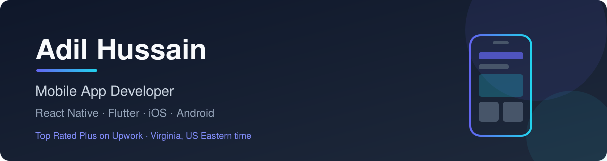

  

 

## About

Most of my work is taking over existing iOS and Android apps and keeping them shipping, with fixes, new features and App Store and Play releases. I also add AI features to apps that already exist, most recently on FurCare AI.

Client code lives in private repos under NDA, so this page is a summary rather than a code sample.

 

## Tech stack

**Mobile**

      

**Backend and cloud**

  

**Integrations**

   

**Releases and tools**

     

 

## Recent Upwork work

| Project | Stack | Value |
|---|---|---:|
| React Native and Expo app optimization | React Native, Expo | $59,928 |
| Lead QA Automation Engineer / SDET, seven months, 5.0 | Flutter, backend, AI | $34,284 |
| Powder Watts, build and deploy | React Native | $10,160 |
| NIXR, features, fixes and store releases | React Native | $9,400 |
| Home health assessment app, web form to iOS and Android (in progress) | iOS, Android | $8,200 |
| ArabGPT, Android app modernization | Kotlin, Android | $7,265 |

Full history and reviews are on my [Upwork profile](https://www.upwork.com/freelancers/~01a078b9f2a2be910a).

 

## Before Upwork

| Period | Role | Company |
|---|---|---|
| 2023 to now | Senior Mobile App Developer, leading a team of 9 | ScriptsBundle |
| 2022 to 2023 | Senior React Native Developer, led a team of 8 | Northwest Partners |
| 2019 to 2022 | Senior React Native and Software Developer | Paradyme Management |
| 2017 to 2019 | Mobile Application Developer | Deloitte |
| 2015 to 2017 | Software Developer | Nolij Consulting |

BS in Computer Science, Clemson University, 2010 to 2014.

 

## What clients have said

> "Adil is an outstanding and thorough app developer. His communication skills and raw talent are unmatched. He will continue to be our top choice for app development and modernization work!"
>
> Senior Android Developer, app modernization

> "Adil has been a pleasure to work with. He is thoughtful, reliable, and consistently delivers high-quality work."
>
> Flutter cross-platform app

 

Reach me through Upwork. I usually reply within a few hours, US Eastern time.

